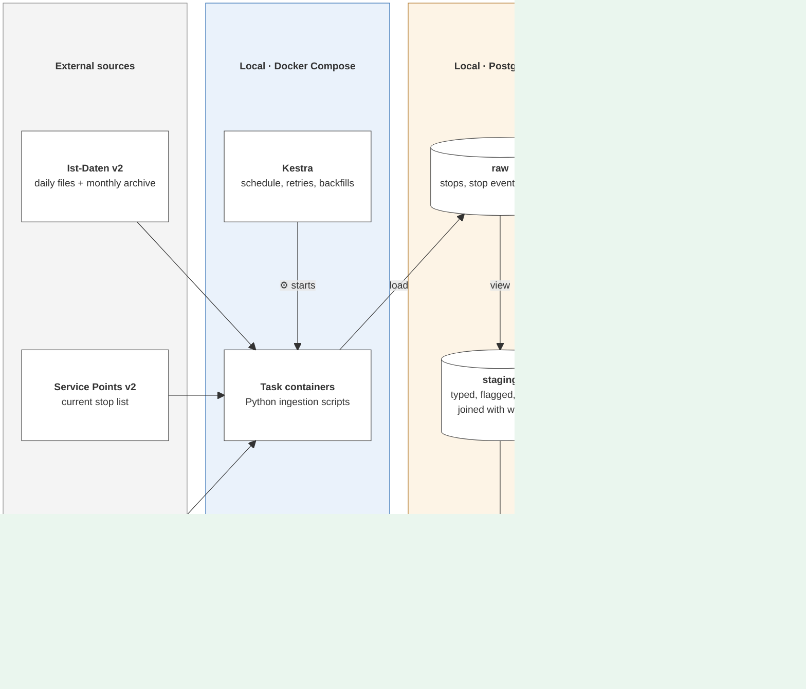

# Weather Impact on Rail Punctuality in the Canton of Lucerne

**DENG HS26 – Data Engineering Project, Hochschule Luzern** \
Emre Sen · Theodora Haimoff


**In short:** a batch pipeline that joins actual train operations data with official
MeteoSwiss weather measurements for the canton of Lucerne, and a **Streamlit dashboard**
where commuters can explore our findings and check the **current delay and cancellation
risk** for their station based on today's weather.

---

## 1. Problem and use case

Train delays and cancellations are more frequent in bad weather, but commuters have no
concrete answer to questions like:

- *"What is the chance my train in the canton of Lucerne is late when it rains or snows, and by how much?"*
- *"How severe does the weather have to be before trains get cancelled?"*

This project builds an end-to-end batch data pipeline that combines **actual train
operations data** with **official MeteoSwiss weather measurements**, classifies the weather
by type and severity, and produces curated tables that answer these questions. The results
are made available to users through a **Streamlit dashboard** with two views:

- **Findings:** how delays and cancellations change with weather type and severity, compared with calm/dry weather, and which stations and lines are most affected.
- **Current risk:** the user selects their station, the dashboard fetches the latest MeteoSwiss measurement, classifies it, and shows the historical probability and typical size of a delay or cancellation under these conditions.

**Intended users**

| User | Need |
|---|---|
| Commuters in the canton of Lucerne (primary) | Check in the dashboard how likely their train is to be delayed or cancelled given the current weather |
| Analysts / regional transport planners (secondary) | Explore in the dashboard (or query directly) which lines and stations are most weather-sensitive |

**Data product:**

1. **Streamlit dashboard** (user-facing) with the findings and current-risk views described above.
2. **Curated analytical tables** in BigQuery (final solution) that feed the dashboard: delay
   distributions and cancellation rates per weather type, severity level, station, line and
   time of day, compared against a calm/dry-weather baseline.

**Important caveat:** delays and cancellations have many causes (technical faults, staff
issues, accidents, personal injuries). The data contains no cause information, so results
are **correlations and conditional probabilities, not causal effects**. See
[docs/use_case.md](docs/use_case.md).

## 2. Scope

| Dimension | Scope |
|---|---|
| Transport mode | Rail only (`PRODUKT_ID = Zug`, compared case-insensitively) |
| Region | The 51 rail stops in the canton of Lucerne, mapped to 5 MeteoSwiss stations |
| Period | Ist-Daten v2, available from 13 July 2025; planned history: one year (October 2025 to September 2026) plus daily updates |
| Weather granularity | Hourly |
| Weather types | Rain, wind, heat, frost (measured); snow, thunderstorms, icy conditions (derived) |

Buses, trams and boats are excluded to keep the project focused and to avoid operators
with incomplete real-time data. The scope and every data decision are checked against the
real data in [notebooks/01_explore_sources.ipynb](notebooks/01_explore_sources.ipynb).

## 3. Data sources

| Source | Content | Access | Update |
|---|---|---|---|
| [opentransportdata.swiss – Ist-Daten v2](https://data.opentransportdata.swiss/dataset/ist-daten-v2) | Scheduled vs. actual arrival/departure times, cancellations, per stop event | Daily CSV, link read from the dataset page (rolling window of the last 50 days); monthly v2 ZIPs in the [archive](https://archive.opentransportdata.swiss/actual_data_archive.htm) for older days | Daily: the previous operating day is available by about 05:15 Swiss time |
| [opentransportdata.swiss – Service Points v2](https://data.opentransportdata.swiss/dataset/service-point-v2) | Stop master data incl. canton and WGS84 coordinates, used for the stop list and weather-station mapping ([cookbook](https://opentransportdata.swiss/en/cookbook/masterdata-cookbook/servicepoints/)) | CSV (current-state file), link read from the dataset page on every run, full snapshot | Daily |
| [MeteoSwiss Open Data – SwissMetNet](https://opendatadocs.meteoswiss.ch/a-data-groundbased/a1-automatic-weather-stations) | Hourly precipitation, temperature, wind gusts per station (5 stations), plus station metadata | STAC API (`data.geo.admin.ch`), CSV per station | Historical (yearly), recent (1 January to yesterday, updated daily), now |

Details (schema, volume, quality risks): [docs/data_sources.md](docs/data_sources.md)

## 4. Architecture (v0.2)



**Legend:** unmarked arrows = data flow (batch) · ⚙ = control (Kestra starts tasks, Terraform provisions resources) · dashed boxes = final version, unchanged since v0.1. In the final version the ingestion tasks also write the raw files to the GCS bucket, and the Streamlit dashboard reads the curated BigQuery tables; Kestra keeps its execution history in its own database (kestra-db), separate from the pipeline data.

Kestra runs the daily flow `check_transport_source → ingest_transport → ingest_weather →
validate_day → transform` for the previous operating day, and the setup flow `rail_weather_stops`
once for the stop list. Full description, storage zones and what changed since the pitch:
[docs/architecture/architecture_v0.2.md](docs/architecture/architecture_v0.2.md). The pitch version
stays in [docs/architecture/architecture_v0.1.md](docs/architecture/architecture_v0.1.md) to show how
the design evolved.

## 5. Design decisions

Every design choice, its reason and its source (course material or our data exploration) is
recorded in [docs/decisions.md](docs/decisions.md). The evidence for the data decisions is in
[notebooks/01_explore_sources.ipynb](notebooks/01_explore_sources.ipynb), where each section ends
with the decision it supports.

## 6. Repository structure

```
.
├── README.md
├── CONTRIBUTING.md                 # workflow and commit message convention
├── LICENSE                         # Apache 2.0 (code; data keeps its source licences)
├── .gitignore                      # secrets, data files, Terraform state, IDE files
├── .env.example                    # example configuration; copy to .env (never committed)
├── requirements.txt                # Python dependencies, pinned (pipeline image and notebooks)
├── compose.yaml                    # PostgreSQL, pgAdmin, Kestra and Kestra's database
├── Dockerfile                      # image that Kestra uses to run the ingestion scripts
├── .dockerignore
├── docs/
│   ├── use_case.md                 # problem, users, questions, data product
│   ├── data_sources.md             # provenance, schema, volume, quality risks
│   ├── decisions.md                # design decisions with reasons and sources
│   ├── project_plan.md             # milestones and backlog
│   └── architecture/
│       ├── architecture_v0.1.md    # pitch architecture (kept to show the evolution)
│       └── architecture_v0.2.md    # midterm architecture, flow, zones, changes since v0.1
├── notebooks/
│   └── 01_explore_sources.ipynb    # data exploration: evidence for the decisions
├── orchestration/
│   ├── application.yaml            # Kestra configuration
│   └── flows/                      # Kestra flows: rail_weather_stops, rail_weather_daily
├── ingestion/                      # pipeline steps: stops, check_source, transport, weather, validate, transform
├── sql/                            # schema.sql (tables), verification.sql (queries for reviewers)
├── transformations/                # SQL views: staging.stop_events, staging.stop_events_weather
├── terraform/                      # GCP infrastructure (planned, final)
├── dashboard/                      # Streamlit dashboard (planned, final)
└── data/                           # downloaded source files, one folder per source, not committed
```

## 7. Setup and execution

> **Status (midterm):** the local pipeline runs end to end in Kestra and was tested on eight
> operating days (8 and 11–18 October 2026), including a rerun of a loaded day and a backfill.
> The cloud part follows in the final version.

**Requirements:** Docker with Docker Compose v2 (Docker Desktop includes both). For the
notebooks only: Python 3.13.

**1. Configure**

```sh
git clone https://github.com/theodorahaimoff/HSLU_HS26_DENG.git
cd HSLU_HS26_DENG
cp .env.example .env
```

Replace every example password in `.env` **before** the first start: database passwords are set
when a database is created, and editing `.env` later does not change them.

**2. Build the pipeline image**

```sh
docker build -t deng-rail-weather:local .
```

Rebuild after every change to `ingestion/` or `sql/`; otherwise Kestra runs the old code.

**3. Start the services**

```sh
docker compose config --quiet    # no output means the configuration is valid
docker compose up -d
docker compose ps                # wait until postgres and kestra-db are healthy
```

| Service | Address | Login |
|---|---|---|
| Kestra | [localhost:8080](http://localhost:8080) | `KESTRA_USER` / `KESTRA_PASSWORD` from `.env` |
| pgAdmin | [localhost:8086](http://localhost:8086) | `PGADMIN_DEFAULT_EMAIL` / `PGADMIN_DEFAULT_PASSWORD` |

pgAdmin starts without a server. Choose **Add New Server**, give it any name, and on the
**Connection** tab enter host `postgres` (the service name inside the Docker network, not
`localhost`), port `5432`, and `POSTGRES_DB`, `POSTGRES_USER` and `POSTGRES_PASSWORD` from `.env`.

**4. Add the flows to Kestra**

In Kestra, open **Flows → Create**, paste the content of
`orchestration/flows/rail_weather_stops.yaml` and save. Repeat for
`orchestration/flows/rail_weather_daily.yaml`.

**5. Run the pipeline**

1. Execute `rail_weather_stops` once. It loads the 51 stops and their weather stations.
2. Execute `rail_weather_daily` and type an `operating_day` from the last few days as
   `YYYY-MM-DD`, e.g. `2026-10-16`. The input is a text field and rejects any other format.
3. Execute the same day again: the logs say how many rows of the earlier load were replaced, and
   the row counts stay the same, because each run replaces that day.
4. Backfill: in `rail_weather_daily`, open **Triggers** and choose **Backfill executions** on
   `daily_schedule`, e.g. start `2026-10-12 00:00`, end `2026-10-13 23:59`, then
   **Execute backfill**. Each scheduled date (09:00) loads the day before it, so this loads 11 and
   12 October. Leave `operating_day` as it is: backfills ignore it.

Each daily file is about 660 MB to download, so keep test runs to a few days.

**6. Verify**

Run the queries in `sql/verification.sql` in pgAdmin: rows per operating day, the 51 stops, the
hourly weather (120 rows per day: 5 stations × 24 hours), the weather join and the quality checks. The `validate_day` task runs the same checks after every load and fails the
execution if one doesn't pass. Screenshots of tested runs are in [docs/evidence/](docs/evidence/).

**Stop and reset**

```sh
docker compose stop        # stop, keep all data
docker compose down        # remove containers, keep data volumes
docker compose down -v     # also delete all loaded data and Kestra history
```

**Exploration notebooks (optional):** create a virtual environment, install
`requirements.txt`, start only the database with `docker compose up -d postgres`, and keep
`POSTGRES_HOST=localhost` in `.env`. Downloaded files go to `data/<source>/`.

## 8. Project plan and collaboration

See [docs/project_plan.md](docs/project_plan.md). Our workflow and commit message
convention ([Conventional Commits](https://www.conventionalcommits.org/)) are described in
[CONTRIBUTING.md](CONTRIBUTING.md).

## 9. Known limitations

Most limitations come from the sources themselves. The right column shows how the pipeline deals
with each one.

| Limitation | How we handle it |
|---|---|
| Ist-Daten has no cause of delay | Results are reported as correlations and conditional probabilities, not causal effects |
| Planned closures look like disruptions (8 Oct 2026: 496 of 558 cancellations were the whole S9 line) | A rule for line-wide closures is being defined; those rows are kept but left out of the weather comparison |
| Journeys without real-time data are missing from Ist-Daten entirely | Can't be detected in the data; documented |
| About 1 % of times are only forecasts (`PROGNOSE`) | Flagged and kept, without a delay value, so they stay countable (D7) |
| Weather is measured at five stations, up to 14 km from a stop | Distance and altitude difference are stored per stop, so weak matches can be identified (D4) |
| Snow, thunderstorms and icy conditions aren't measured directly; automatic snow depth isn't quality-checked | Derived from precipitation, temperature and gusts; snow is treated as the least reliable weather type |
| MeteoSwiss warning levels are defined for regional forecasts | Applied to measured station values; documented with the severity levels |
| Weather (UTC, hour labelled by its end) and trains (Swiss local time) use different times | Converted in the staging join (D15); a train after midnight gets its weather once the next day is loaded |
| Weather ingestion reads the "recent" files, so backfills work within the current year | The yearly "historical" files are added for the final, together with the one-year backfill |
| Download links are read from the dataset pages | The source check fails with a clear message if a page changes (D8) |
| The dashboard's "current risk" is not a live prediction | It combines the latest weather measurement with historical probabilities from the batch pipeline |

## 10. Data attribution

- Transport data: Open Data Platform Mobility Switzerland (opentransportdata.swiss).
- Weather data: Source: MeteoSwiss.