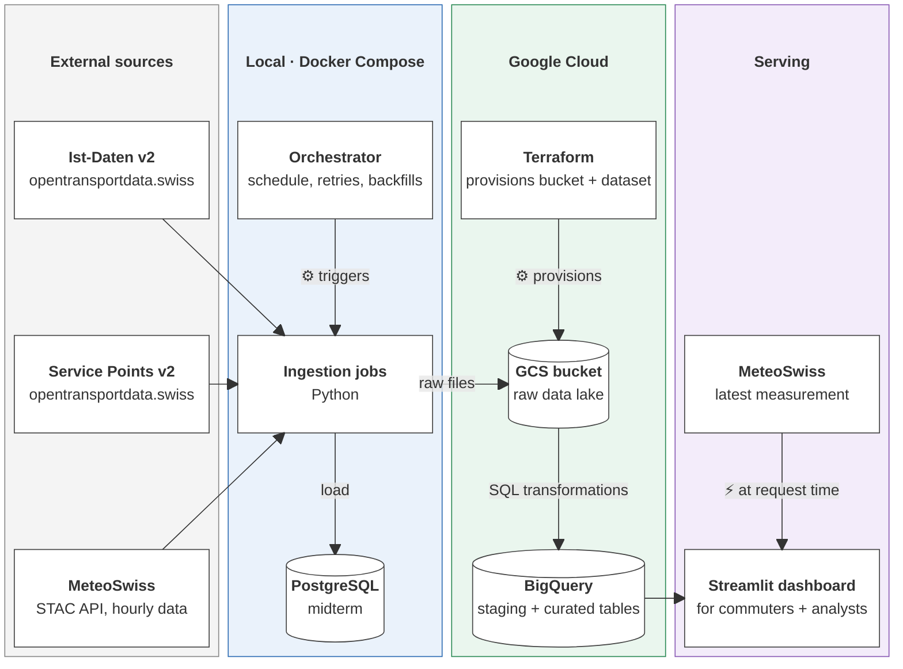

# Weather Impact on Rail Punctuality in the Canton of Lucerne

**DENG HS26 – Data Engineering Project, Hochschule Luzern** \
Emre Sen · Theodora Haimoff


**In short:** a batch pipeline that joins actual train operations data with official
MeteoSwiss weather measurements for the canton of Lucerne, and a **Streamlit dashboard**
where commuters can explore our findings and check the **current delay and cancellation
risk** for their station based on today's weather.

---

## 1. Problem and use case

Train delays and cancellations are more frequent in bad weather, but commuters have no
concrete answer to questions like:

- *"What is the chance my train in the canton of Lucerne is late when it rains or snows, and by how much?"*
- *"How severe does the weather have to be before trains get cancelled?"*

This project builds an end-to-end batch data pipeline that combines **actual train
operations data** with **official MeteoSwiss weather measurements**, classifies the weather
by type and severity, and produces curated tables that answer these questions. The results
are made available to users through a **Streamlit dashboard** with two views:

- **Findings:** how delays and cancellations change with weather type and severity, compared with calm/dry weather, and which stations and lines are most affected.
- **Current risk:** the user selects their station, the dashboard fetches the latest MeteoSwiss measurement, classifies it, and shows the historical probability and typical size of a delay or cancellation under these conditions.

**Intended users**

| User | Need |
|---|---|
| Commuters in the canton of Lucerne (primary) | Check in the dashboard how likely their train is to be delayed or cancelled given the current weather |
| Analysts / regional transport planners (secondary) | Explore in the dashboard (or query directly) which lines and stations are most weather-sensitive |

**Data product:**

1. **Streamlit dashboard** (user-facing) with the findings and current-risk views described above.
2. **Curated analytical tables** in BigQuery (final solution) that feed the dashboard: delay
   distributions and cancellation rates per weather type, severity level, station, line and
   time of day, compared against a calm/dry-weather baseline.

**Important caveat:** delays and cancellations have many causes (technical faults, staff
issues, accidents, personal injuries). The data contains no cause information, so results
are **correlations and conditional probabilities, not causal effects**. See
[docs/use_case.md](docs/use_case.md).

## 2. Scope

| Dimension | Scope |
|---|---|
| Transport mode | Rail only (`PRODUKT_ID = Zug`, compared case-insensitively) |
| Region | The 51 rail stops in the canton of Lucerne, mapped to 5 MeteoSwiss stations |
| Period | Ist-Daten v2, available from 13 July 2025; planned history: one year (October 2025 to September 2026) plus daily updates |
| Weather granularity | Hourly |
| Weather types | Rain, wind, heat, frost (measured); snow, thunderstorms, icy conditions (derived) |

Buses, trams and boats are excluded to keep the project focused and to avoid operators
with incomplete real-time data. The scope and every data decision are checked against the
real data in [notebooks/01_explore_sources.ipynb](notebooks/01_explore_sources.ipynb).

## 3. Data sources

| Source | Content | Access | Update |
|---|---|---|---|
| [opentransportdata.swiss – Ist-Daten v2](https://data.opentransportdata.swiss/dataset/ist-daten-v2) | Scheduled vs. actual arrival/departure times, cancellations, per stop event | Daily CSV, link read from the dataset page (rolling window of the last 50 days); monthly v2 ZIPs in the [archive](https://archive.opentransportdata.swiss/actual_data_archive.htm) for older days | Daily: the previous operating day is available by about 05:15 Swiss time |
| [opentransportdata.swiss – Service Points v2](https://data.opentransportdata.swiss/dataset/service-point-v2) | Stop master data incl. canton and WGS84 coordinates, used for the stop list and weather-station mapping ([cookbook](https://opentransportdata.swiss/en/cookbook/masterdata-cookbook/servicepoints/)) | CSV download (current-state file), full snapshot | Daily |
| [MeteoSwiss Open Data – SwissMetNet](https://opendatadocs.meteoswiss.ch/a-data-groundbased/a1-automatic-weather-stations) | Hourly precipitation, temperature, wind gusts per station (5 stations), plus station metadata | STAC API (`data.geo.admin.ch`), CSV per station | Historical (yearly), recent (1 January to yesterday, updated daily), now |

Details (schema, volume, quality risks): [docs/data_sources.md](docs/data_sources.md)

## 4. Architecture (v0.1)



**Legend:** unmarked arrows = data flow (batch) · ⚙ = control (the orchestrator starts jobs, Terraform provisions resources) · ⚡ = live call at request time

Full description, ingestion strategy and division of responsibilities:
[docs/architecture/architecture_v0.1.md](docs/architecture/architecture_v0.1.md)

**Since v0.1:** the orchestrator is **Kestra**, set up like the course's Week 5 lab (Kestra with
its own metadata database, our scripts run in temporary containers from our own image). The daily
flow is `check_transport_source → ingest_transport → ingest_weather → validate_day`. Architecture
v0.2 follows with the midterm submission; the changes and their reasons are in
[docs/decisions.md](docs/decisions.md).

## 5. Design decisions

Every design choice, its reason and its source (course material or our data exploration) is
recorded in [docs/decisions.md](docs/decisions.md). The evidence for the data decisions is in
[notebooks/01_explore_sources.ipynb](notebooks/01_explore_sources.ipynb), where each section ends
with the decision it supports.

## 6. Repository structure

```
.
├── README.md
├── CONTRIBUTING.md                 # workflow and commit message convention
├── LICENSE                         # Apache 2.0 (code; data keeps its source licences)
├── .gitignore                      # secrets, data files, Terraform state, IDE files
├── .env.example                    # example configuration; copy to .env (never committed)
├── requirements.txt                # Python dependencies, pinned (pipeline image and notebooks)
├── compose.yaml                    # PostgreSQL, pgAdmin, Kestra and Kestra's database
├── Dockerfile                      # image that Kestra uses to run the ingestion scripts
├── .dockerignore
├── docs/
│   ├── use_case.md                 # problem, users, questions, data product
│   ├── data_sources.md             # provenance, schema, volume, quality risks
│   ├── decisions.md                # design decisions with reasons and sources
│   ├── project_plan.md             # milestones and backlog
│   └── architecture/
│       └── architecture_v0.1.md    # initial architecture and responsibilities
├── notebooks/
│   └── 01_explore_sources.ipynb    # data exploration: evidence for the decisions
├── orchestration/
│   ├── application.yaml            # Kestra configuration
│   └── flows/                      # Kestra flows: rail_weather_stops, rail_weather_daily
├── ingestion/                      # batch ingestion scripts (in progress)
├── sql/                            # table definitions and verification queries (in progress)
├── transformations/                # SQL transformations (planned)
├── terraform/                      # GCP infrastructure (planned, final)
├── dashboard/                      # Streamlit dashboard (planned, final)
└── data/                           # downloaded source files, one folder per source, not committed
```

## 7. Setup and execution

> **Status:** the environment (Docker Compose, Kestra, flows) is in place; the ingestion scripts
> the flows call are being written. Steps 4–6 work once `ingestion/` is complete.

**Requirements:** Docker with Docker Compose v2 (Docker Desktop includes both). For the
notebooks only: Python 3.13.

**1. Configure**

```sh
git clone https://github.com/theodorahaimoff/HSLU_HS26_DENG.git
cd HSLU_HS26_DENG
cp .env.example .env
```

Replace every example password in `.env` **before** the first start: database passwords are set
when a database is created, and editing `.env` later does not change them.

**2. Build the pipeline image**

```sh
docker build -t deng-rail-weather:local .
```

Rebuild after every change to `ingestion/` or `sql/`; otherwise Kestra runs the old code.

**3. Start the services**

```sh
docker compose config --quiet    # no output means the configuration is valid
docker compose up -d
docker compose ps                # wait until postgres and kestra-db are healthy
```

| Service | Address | Login |
|---|---|---|
| Kestra | [localhost:8080](http://localhost:8080) | `KESTRA_USER` / `KESTRA_PASSWORD` from `.env` |
| pgAdmin | [localhost:8086](http://localhost:8086) | `PGADMIN_DEFAULT_EMAIL` / `PGADMIN_DEFAULT_PASSWORD`; register a server with host `postgres`, port `5432` and the `POSTGRES_*` values |

**4. Add the flows to Kestra**

In Kestra, open **Flows → Create**, paste the content of
`orchestration/flows/rail_weather_stops.yaml` and save. Repeat for
`orchestration/flows/rail_weather_daily.yaml`.

**5. Run the pipeline**

1. Execute `rail_weather_stops` once. It loads the 51 stops and their weather stations.
2. Execute `rail_weather_daily` with an `operating_day` from the last few days.
3. Execute the same day again: the row counts stay the same, because each run replaces that day.
4. Backfill: in `rail_weather_daily`, open **Triggers**, choose **Backfill** on `daily_schedule` and
   select two or three past days. Each scheduled date loads the day before it.

Each daily file is about 660 MB to download, so keep test runs to a few days.

**6. Verify**

Run the queries in `sql/verification.sql` in pgAdmin: rows per operating day, the 51 stops, and the
quality checks. The `validate_day` task runs the same checks after every load and fails the
execution if one doesn't pass.

**Stop and reset**

```sh
docker compose stop        # stop, keep all data
docker compose down        # remove containers, keep data volumes
docker compose down -v     # also delete all loaded data and Kestra history
```

**Exploration notebooks (optional):** create a virtual environment, install
`requirements.txt`, start only the database with `docker compose up -d postgres`, and keep
`POSTGRES_HOST=localhost` in `.env`. Downloaded files go to `data/<source>/`.

## 8. Project plan and collaboration

See [docs/project_plan.md](docs/project_plan.md). Our workflow and commit message
convention ([Conventional Commits](https://www.conventionalcommits.org/)) are described in
[CONTRIBUTING.md](CONTRIBUTING.md).

## 9. Known risks and limitations

- No cause-of-delay information; results are correlational.
- Planned closures can't be told apart from disruptions: Ist-Daten has no planned/unplanned flag.
  On 8 October 2026, 496 of 558 cancellations at our stops were the whole S9 line for the day.
  A rule for line-wide closures is being defined.
- Journeys without real-time data are missing entirely from Ist-Daten.
- About 1 % of times are only forecasts (`PROGNOSE`), not measurements; they are flagged and get no delay value.
- Automatic snow-depth measurements are not quality-checked by MeteoSwiss and struggle with the first
  centimetres in the lowlands; snow is therefore derived and is the least reliable weather type.
- Thunderstorms and icy conditions are not measured directly and are approximated.
- Severity levels follow MeteoSwiss's warning levels, which are defined for regional forecasts; we apply
  them to measured station values.
- Weather is measured at five stations (up to 14 km from a stop) and may not represent conditions at every stop.
- MeteoSwiss timestamps are in UTC, Ist-Daten times in Swiss local time; they are converted before the join.
- Arrivals and departures behave differently (on 8 October, median delay 0.9 min on arrival and
  1.5 min on departure) and are analysed separately, which also handles Luzern as a terminal station.
- The Ist-Daten download link is read from the dataset page; a redesign of that page would break the
  lookup, and the source check fails with a clear message if it does.
- The dashboard's "current risk" is not a live train-delay prediction: it combines the latest weather measurement with historical probabilities computed by the batch pipeline.

## 10. Data attribution

- Transport data: Open Data Platform Mobility Switzerland (opentransportdata.swiss).
- Weather data: Source: MeteoSwiss.