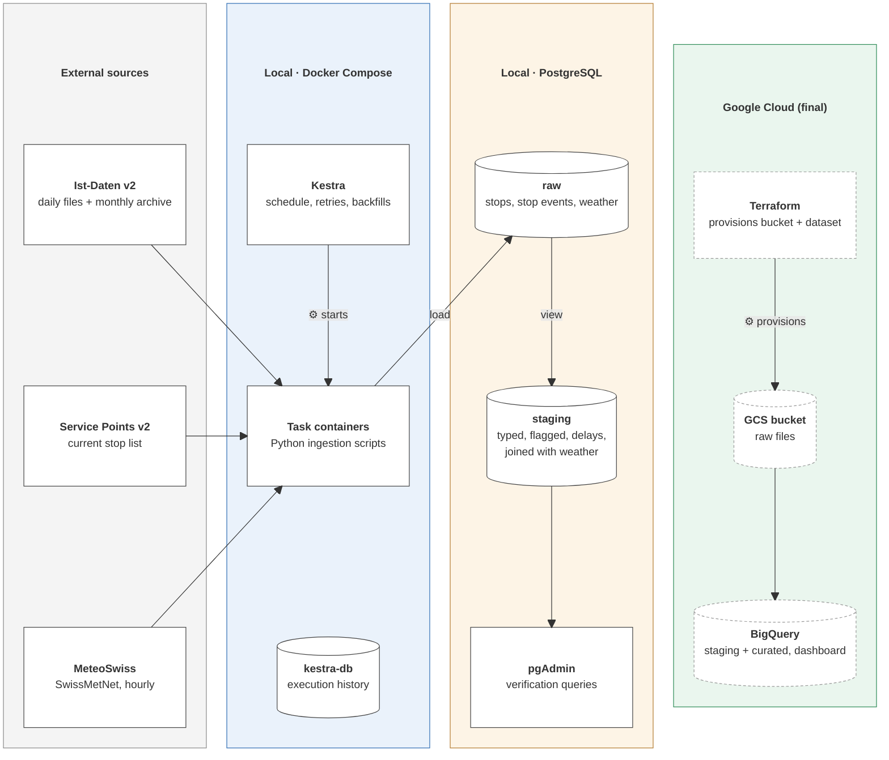

# Architecture v0.2 (midterm)

**Status:** the local pipeline as built for the midterm (October 2026). The cloud part is unchanged
from [v0.1](architecture_v0.1.md) and follows in the final version. The reasons for every change are
in [../decisions.md](../decisions.md); the evidence from the data is in
[../../notebooks/01_explore_sources.ipynb](../../notebooks/01_explore_sources.ipynb).

## Overview

**Legend:** unmarked arrows = data flow (batch) · ⚙ = control (Kestra starts tasks, Terraform provisions resources) · dashed boxes = final version, unchanged since v0.1. In the final version the ingestion tasks also write the raw files to the GCS bucket, and the Streamlit dashboard reads the curated BigQuery tables; Kestra keeps its execution history in its own database (kestra-db), separate from the pipeline data.

## The daily flow

Kestra runs the flow `rail_weather_daily` every day at 09:00 Swiss time for the **previous operating
day** (the scheduled date minus one day, never the machine's clock), so a backfill over past dates
processes exactly those days. A manual run takes the day from the execution form, typed as
`YYYY-MM-DD` (D11).

| Task | Script | What it does | On failure |
|---|---|---|---|
| `check_transport_source` | `ingestion/check_source.py` | Finds the day's file on the dataset page and checks it can be downloaded | Retries every 30 min, 4 attempts (the file may be late) |
| `ingest_transport` | `ingestion/transport.py` | Downloads the day (about 660 MB) to a temporary folder, keeps the rail rows at our 51 stops (about 5,500), replaces that day in `raw.stop_events` | Retries every 2 min, 3 attempts; rolls back, the previous version stays |
| `ingest_weather` | `ingestion/weather.py` | Finds each station's hourly "recent" file through the STAC API, keeps the 7 parameters for the hours of that Swiss calendar day (24, or 23/25 when the clocks change), replaces that day in `raw.weather_hourly` (120 rows) | Same as transport |
| `validate_day` | `ingestion/validate.py` | Checks the loaded day: rows exist, every stop is known, only known status and flag values; every weather station has all hours, the core parameters and plausible values | No retry: the execution fails |
| `transform` | `ingestion/transform.py` | Creates or updates both staging views and checks they keep every row | No retry |

The setup flow `rail_weather_stops` runs `ingestion/stops.py` once, and again when the service points
change: it rebuilds `raw.stops` (51 stops, each with its nearest weather station).

Every script also runs without Kestra (`python -m ingestion.<script> --date YYYY-MM-DD`), which is
how they are developed and tested.

## Storage zones

| Zone | Where (midterm) | Grain | Contents |
|---|---|---|---|
| `raw.stops` | PostgreSQL table | one stop | 51 rail stops in canton LU with coordinates, height and their weather station |
| `raw.stop_events` | PostgreSQL table | one journey at one stop on one operating day | The 22 Ist-Daten columns unchanged, plus `operating_day`, `source_file`, `ingested_at` |
| `raw.weather_hourly` | PostgreSQL table | one station and hour | Hourly MeteoSwiss values for the 5 stations |
| `staging.stop_events` | PostgreSQL view | same as `raw.stop_events` | Typed times, stop role, what each time is based on, arrival and departure delay in minutes |
| `staging.stop_events_weather` | PostgreSQL view | same as `raw.stop_events` | Every stop event with its station's weather for the hour of its scheduled time (D15) |

In the final version the same zones move to the cloud: raw files to the GCS bucket, tables to BigQuery,
plus curated tables for the dashboard.

## What changed since v0.1

| Area | v0.1 (pitch) | v0.2 (midterm) | Why | Decision |
|---|---|---|---|---|
| Orchestrator | Open | Kestra, set up like the course lab, with its own metadata database | Taught in Week 5; the tasks run our code in temporary containers | D12 |
| Ingestion | "Ingestion jobs" | One Python module per step, each taking `--date`; one Docker image | Scripts run with or without Kestra; the date comes from the schedule | D11 |
| Loading | Not specified | Replace the day in one transaction: lock, delete, insert, compare counts | Reruns never duplicate; a failure leaves the previous version | D10 |
| Filtering | Filter to our stops | Filter at ingestion, but keep every column unchanged; clean later | A day is 2.6 M rows, ours are 0.2 % | D6 |
| Data quality | Use `REAL` times only | Flag every row instead of dropping it; delays NULL without a measured time | Exclusions stay countable; `UNBEKANNT` turned out to mean cancelled | D7 |
| Reliability | Retries | Source check first, validation last, retries only for temporary failures | A green load is not proof; a schema change must not be retried | D8, D9 |
| Source links | Fixed download URLs | Links read from the dataset pages on every run | Files get new IDs when republished (the service points URL broke on 15 Oct) | D8 |
| History | Monthly archive | Monthly **v2** ZIPs from the archive, read day by day without unpacking | The daily page only keeps 50 days; archive and daily files are identical | D13 |
| Schedule | Daily | 09:00 Swiss time | Yesterday's transport file is published by about 05:15, the weather file by about 04:40 | – |
| Weather | Hourly SwissMetNet values | The "recent" file per station via the STAC API, day replaced like transport, values unchanged | One file covers 1 January to yesterday; reloading picks up corrections | D14 |
| Join | Weather per stop and hour | View joining each stop event to the hour of its scheduled time | Cancelled trains have no actual time; MeteoSwiss labels hours by their end, in UTC | D15 |
| Run input | Date picker | `operating_day` as text with a `YYYY-MM-DD` check | Kestra's backfill sent the date input as a UTC timestamp and rejected it | D11 |
| Weather mapping | Nearest station | Nearest station within 300 m altitude difference: CHZ, EGO, LUZ, MOA, SPF | Keeps 5 stops off the Pilatus and Napf mountain stations | D4 |

**Unchanged since v0.1:** the scope (rail, canton Lucerne, hourly weather), the three sources, the
cloud target (GCS, BigQuery, Terraform) and the Streamlit dashboard.

## Responsibilities

| Area | Lead |
|---|---|
| Transport ingestion, stop list and station mapping, source check, validation | Theodora Haimoff |
| Weather ingestion, Docker and PostgreSQL, Kestra flows and testing | Emre Sen |
| Staging transformation, verification queries | both |
| Severity classification, BigQuery loading and data quality (final) | Theodora Haimoff |
| Terraform and GCS, curated data model, dashboard container and docs (final) | Emre Sen |